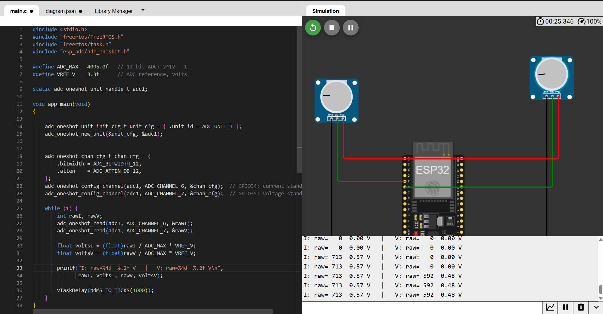

# Smart Energy Meter (ESP32, ESP-IDF)

An ESP32-based energy meter written in embedded C using ESP-IDF. It computes RMS
voltage and current, real power, apparent power, power factor and accumulated
energy, and logs the readings to Firebase Realtime Database over WiFi.

**Status:** Simulation stage complete (Wokwi). Hardware stage (ACS712 + ZMPT101 on
the bench, calibration against a reference meter) is planned next.

## Features
- 12-bit ADC reads with the ESP-IDF one-shot driver (ADC1, GPIO34/GPIO35);
  potentiometers stand in for the sensors in simulation
- DC-offset removal and RMS calculation over one 50 Hz cycle (200 samples,
  synthetic in simulation)
- Real power from the average of instantaneous v x i, apparent power, power factor
- Energy accumulation (Wh) from real elapsed time
- WiFi station mode with event-driven connection handling
- HTTPS POST of JSON readings to Firebase Realtime Database
- FreeRTOS task for the measurement loop

## How it works
1. Read the ADC channels (potentiometers set the signal amplitude in simulation).
2. Build one synthetic AC cycle (on hardware: sample the ADC at fixed intervals).
3. Remove the DC offset, then compute Vrms, Irms and real power.
4. Compute S, PF and energy.
5. Print to serial, and every 5 s send a JSON record to Firebase.

## Simulation notes (please read)
- The simulator has no ACS712 or ZMPT101, so two potentiometers set the amplitude
  of a **synthetic AC test signal** (30 degree phase lag) generated in firmware.
- The measurement maths (RMS, power, PF, energy) is the code intended for hardware.
  On hardware, the synthetic samples are replaced by real ADC samples.
- `V_PER_COUNT` and `I_PER_COUNT` are **placeholder scale factors** and will be
  calibrated against a reference meter on the bench.

## Validation (simulation)
| Quantity | Hand calculation | Firmware output |
|---|---|---|
| Apparent power S (13.7 V, 4.06 A) | 13.7 x 4.06 = 55.6 VA | 55.6 VA |
| Power factor | cos(30 deg) = 0.87 | 0.87 |
| Energy step per second (48.1 W) | 48.1 / 3600 = 0.0134 Wh | about 0.0135 Wh |
| Apparent power S (113.2 V, 3.54 A) | 113.2 x 3.54 = 400.7 VA | 400.6 VA |
| Real power P (S x 0.866) | 400.6 x 0.866 = 346.9 W | 347.0 W |

## Screenshots
**Stage A: raw ADC readings from the potentiometers**

**WiFi connection in the simulator**

**Stage B/C: Vrms, Irms, P, PF and energy, with Firebase HTTP 200**

**Readings stored in Firebase**

## Run it
- Simulation: open the Wokwi project (link to be added).
- The firmware was built and run in Wokwi's ESP-IDF v5.3 environment. A local
  `idf.py build` has not been verified yet.
- Set your own Firebase database URL, WiFi name and password at the top of
  `Firmware/main.c`. In the Wokwi simulator, use `Wokwi-GUEST` with an empty password.

## Next steps
- Hardware bring-up with ACS712 and ZMPT101
- Replace the synthetic samples with timer-driven or continuous ADC sampling
- Investigate noise, grounding and signal conditioning
- Calibrate against reference readings and record the results
- Dashboard view of the Firebase data

## Author
Mohamed Aslam H
